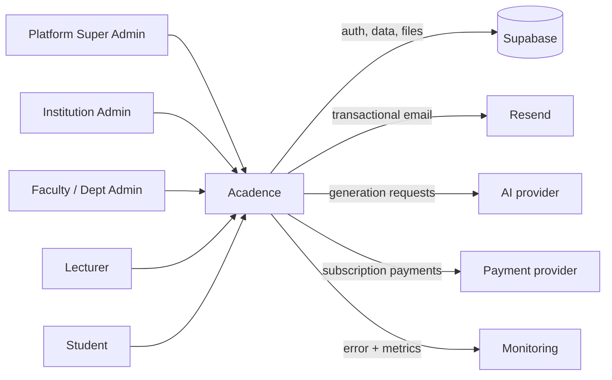
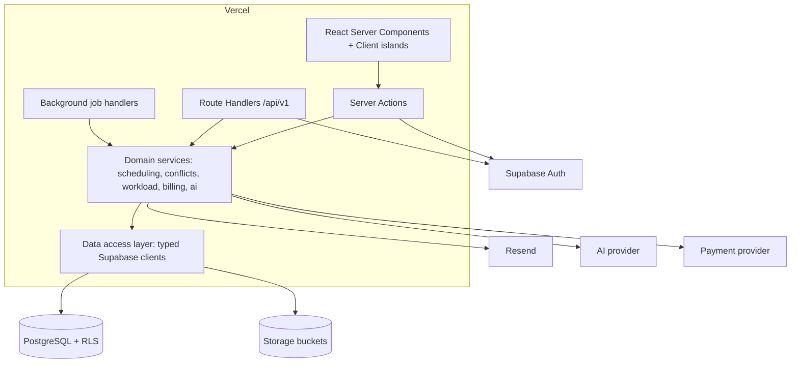
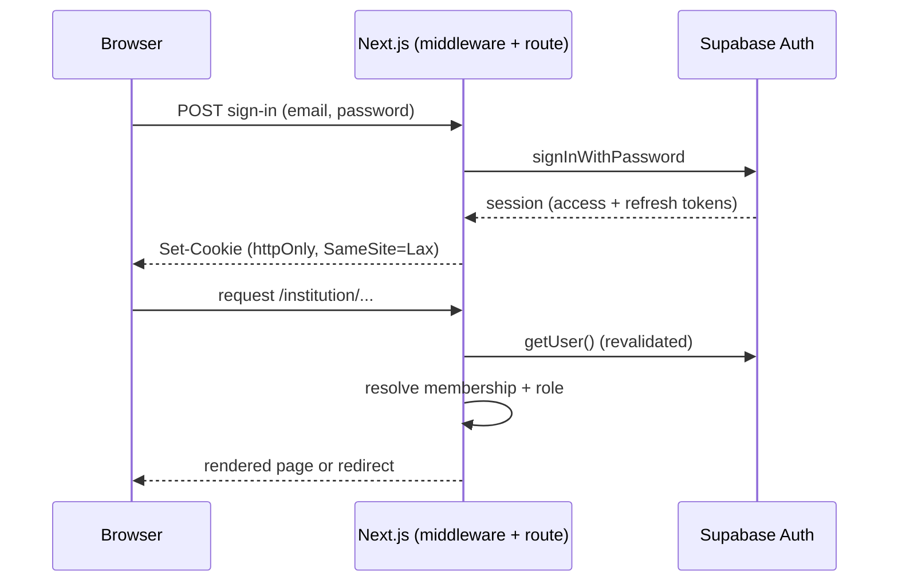
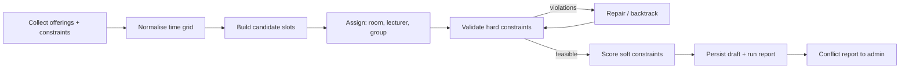
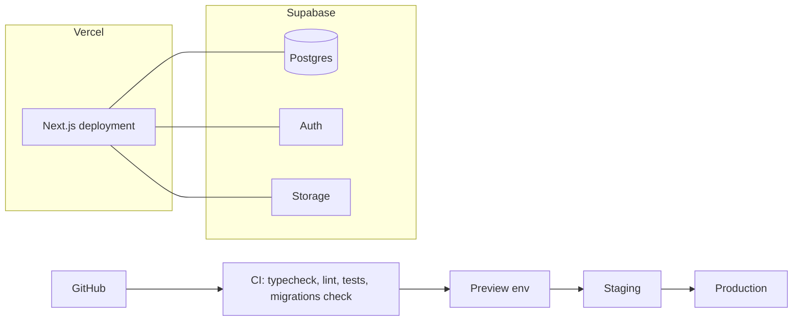

# Acadence — System Architecture

> **Document ID:** ARC-001 · **Version:** 1.0 · **Status:** Approved direction, review findings open · **Date:** 2026-11-23 · **Owner:** Principal Architect
> **Related:** [SRS](../03-requirements/SRS.md) · [Database](../05-database/DATABASE_DESIGN.md) · [API](../06-api/API_SPECIFICATION.md) · [Design System](../07-ui-ux/DESIGN_SYSTEM.md) · [ADR-001](../13-adr/ADR-001-modular-monolith.md) · [ADR-002](../13-adr/ADR-002-nextjs-supabase-vercel.md)

## 1. Architectural summary

Acadence is a **modular monolith**: one Next.js application (server-rendered UI, Server Actions and Route Handlers), one Supabase PostgreSQL database with RLS as the tenant boundary, Supabase Auth for identity, Supabase Storage for files, and Resend for email. The scheduling engine is an in-process TypeScript module behind an interface that a future Python/OR-Tools worker can implement.

```
Browser ──HTTPS──> Next.js on Vercel ──> Supabase (Postgres + RLS, Auth, Storage)
                          │                    ▲
                          ├── Resend (email)   └── scheduled jobs / queues
                          └── AI provider (server-side only)
```

## 2. Stack validation

| Technology | Verdict | Notes and limitations |
| --- | --- | --- |
| Next.js 16 (App Router) + TypeScript | **Adopt** | Server Components carry tenant-scoped reads; Server Actions and Route Handlers carry mutations. Cache Components is enabled — tenant data must never be cached without an explicit tenant-scoped key. |
| Tailwind CSS v4 + shadcn/ui + Lucide + Recharts | **Adopt** | Matches the reference design; no additional UI framework. |
| Supabase PostgreSQL | **Adopt** | Postgres 15+ with `btree_gist` for overlap constraints. Connection pooling via Supavisor is mandatory serverless. |
| Supabase Auth | **Adopt** | Email/password + OAuth providers; invitation and reset flows supported. SAML/SCIM deferred (assumptions register). |
| RLS | **Adopt** | Primary isolation boundary. All tenant tables carry `institution_id`; policies use `SECURITY DEFINER` helper functions to avoid recursive policy evaluation. |
| Supabase Storage | **Adopt** | Private buckets per environment, signed URLs, storage policies scoped by institution path prefix. |
| Supabase Queues / background workers | **Adopt with caveat** | Request-bound work (publish validation) runs synchronously; long generation and email fan-out are queued jobs. Worker execution time limits are documented in §10. |
| Vercel | **Adopt** | Serverless function duration limits constrain generation size; generation must be chunked or offloaded (§10, §14). |
| Resend | **Adopt** | Domain verification per environment; batching for fan-out. |
| AI API (server-side) | **Adopt** | Provider key server-only, per-institution credit ledger, per-user daily cap, model allowlist. |
| Python + Google OR-Tools | **Deferred** | Interface boundary defined now (ADR-004); implementation only after Phase 8 evaluation proves the TypeScript engine insufficient. |
| Microservices | **Rejected** | No operational need; see ADR-001. |

## 3. System context



## 4. Container view



Request path rules:

1. UI reads through Server Components → DAL → Postgres (RLS applies).
2. Mutations go through Server Actions (form flows) or Route Handlers (integrations/webhooks), never direct table calls from components.
3. Services own business rules; the DAL owns queries; components own presentation only.

## 5. Application layers and module boundaries

```
src/
  app/                 routes only — no business logic
  components/          presentation (ui, layout, dashboard, shared)
  modules/<domain>/    domain UI + actions for a bounded context
  services/            cross-module business rules (scheduling, conflicts, billing)
  lib/supabase/        client factories (browser, server, admin)
  lib/auth/            session, membership and capability resolution
  lib/validation/      zod schemas shared by actions and handlers
  config/              site, navigation, env
  types/               domain types and generated database types
```

Module boundaries (each owns its tables, services and components):

`institutions` · `users` · `academics` · `classrooms` · `timetables` · `scheduling` · `conflicts` · `workloads` · `calendars` · `attendance` · `notifications` · `ai-learning` · `documents` · `analytics` · `subscriptions`

**Dependency rules**

- A module may depend on `lib/*`, `config/*`, `types/*` and its own files.
- Cross-module dependencies go through a service function or a shared type, never by importing another module's components.
- `conflicts` may read timetable data through `timetables` service functions; `scheduling` may call `conflicts` to validate output.
- No circular imports; enforced by review and lint import rules.

## 6. Authentication and authorisation

### 6.1 Authentication flow



- Middleware refreshes the session and redirects unauthenticated users away from protected route groups.
- `getUser()` is called on the server for protected reads; the client-supplied role is never trusted.
- Route group mapping: `(public)`, `(auth)`, `platform/`, `institution/`, `faculty/`, `lecturer/`, `student/`.

### 6.2 Authorisation model

Three layers, all required:

1. **RLS** — row-level truth, keyed on `institution_id` and membership scope.
2. **Server checks** — `requireMembership(institutionId)` and `requireCapability(capability, scope)` before any service call.
3. **UI** — navigation and actions hidden by capability, for usability only, never for security.

Capabilities are derived centrally (`lib/auth/capabilities.ts`) from role + scope so that the sidebar, actions and API share one source of truth.

### 6.3 Platform administration

Platform Super Admin has a platform membership with no institution scope. Access to tenant data is:

- read-only by default, through audited service functions;
- via an explicit support mode that records reason, actor, tenant and duration in `audit_logs`;
- never via a browser-visible service-role key.

## 7. Multi-tenancy

### 7.1 Tenant identification

| Concern | Decision |
| --- | --- |
| Tenant key | `institutions.id` (uuid) on every tenant-owned row |
| User–tenant link | `institution_memberships` (user, institution, role, faculty/department scope, status) |
| Tenant resolution | From the authenticated user's active membership, or the path parameter verified against membership; never from a client-supplied header alone |
| Sharing across tenants | Prohibited for academic data; platform-level lookups (plans, countries) are global tables with read-only access |

### 7.2 Isolation diagram

```mermaid
flowchart TB
  U[user] --> M1[membership: Institution A / Dept Admin]
  U --> M2[membership: Institution B / Lecturer]
  M1 --> A[(Institution A rows)]
  M2 --> B[(Institution B rows)]
  RLS{RLS policy<br/>institution_id ∈ auth_institution_ids()<br/>AND scope allows capability}
  A --- RLS
  B --- RLS
```

### 7.3 Rules

- Every tenant table has `institution_id NOT NULL` with an FK and an index.
- Child tables carry `institution_id` even when derivable, so policies stay flat and fast.
- Composite FKs `(id, institution_id)` prevent cross-tenant references.
- `SECURITY DEFINER` helpers: `auth_institution_ids()`, `auth_role(institution_id)`, `auth_department_ids(institution_id)`; `search_path` pinned.
- Isolation tests create two institutions and assert the second cannot read/write the first's rows through any exposed endpoint or policy path.

## 8. Data access patterns

- Generated `Database` types from the Supabase schema; no `any` in services.
- Queries are colocated in `modules/*/queries.ts` or `services/*`; components receive typed props.
- Pagination is cursor or range based with a maximum page size; no unbounded list queries.
- Mutations run in a transaction when they touch multiple tables (publish, import commit, generation commit) via Postgres functions (`rpc`) or a single statement with CTEs.
- Optimistic concurrency: `updated_at`/`version` checks on publish and approval actions.

## 9. Scheduling engine

### 9.1 Pipeline



### 9.2 Interfaces (stable boundary)

```ts
export interface SchedulingEngine {
  generate(input: SchedulingInput): Promise<SchedulingResult>;
  validate(input: SchedulingInput): ConflictReport;
}

export type SchedulingInput = {
  institutionId: string;
  semesterId: string;
  offerings: OfferingRequirement[];
  rooms: RoomCandidate[];
  lecturers: LecturerAvailability[];
  groups: GroupAvailability[];
  calendar: TeachingCalendar;
  hardRules: HardRuleSet;
  softWeights: SoftWeights;
  fixedEntries: TimetableEntryInput[];
};
```

- Input is fully materialised before work begins so the same input can be replayed (stored with the run).
- Validation is pure and synchronous; generation may be incremental.
- An OR-Tools implementation would consume `SchedulingInput` and emit the same `SchedulingResult`.
- The engine never publishes; publication is a separate, authorised, validated action.

### 9.3 Constraint taxonomy

| Class | Examples | Effect |
| --- | --- | --- |
| Hard | Lecturer/room/group overlap, capacity, room type, unavailable lecturer, fixed entry collision, calendar exclusion | Blocks publication |
| Soft | Preferred slots, gap minimisation, room proximity, workload balance, utilisation balance | Score / warnings |

## 10. Background processing

| Job | Trigger | Execution |
| --- | --- | --- |
| Publish validation | Publish action | Synchronous (must be authoritative) |
| Bulk import commit | Import upload | Synchronous per file with row limit |
| Timetable generation | Admin request | Queued job, progress row, cancellable |
| Notification fan-out | Publish/approve | Queued, batched |
| Email send | Notification job | Queued with retry and delivery status |
| Document/PDF generation | User request | Queued, result in Storage |
| Analytics rollup | Scheduled | Cron-triggered job, per-institution aggregates |

Job rows are tenant-scoped, idempotent (`job_key`), and record attempts and last error. A job that exceeds the platform function limit marks itself `pending_continuation` and resumes from a checkpoint rather than silently failing.

## 11. Notifications, storage and AI

- **Notifications:** event → `notifications` row (in-app) → email job. Preferences stored per user per institution.
- **Storage:** buckets `course-materials`, `documents`, `branding`, all private. Object paths start with `institution_id/`; storage policies mirror RLS. Downloads use short-lived signed URLs.
- **AI:** request → entitlement + credit check → server-side provider call with course context → stored generation + credit debit. Provider errors never leak keys or raw prompts to the browser.

## 12. Errors, logging, monitoring

- Server actions return typed results `{ ok: true, data } | { ok: false, code, message, fields? }`; thrown errors are reserved for programmer faults.
- Error codes are enumerated (`AUTH_REQUIRED`, `FORBIDDEN`, `VALIDATION_FAILED`, `CONFLICT`, `LIMIT_EXCEEDED`, `RATE_LIMITED`, `INTERNAL`).
- Logs are structured JSON with request ID, actor, institution, route and duration; no PII beyond identifiers.
- Monitoring captures server errors, failed jobs, publish rejections and AI failures; alert thresholds documented in operations docs (Phase 20).

## 13. Deployment



- One Supabase project per environment; migrations applied through versioned files in `supabase/migrations`.
- Environment variables: `NEXT_PUBLIC_SUPABASE_URL`, `NEXT_PUBLIC_SUPABASE_ANON_KEY`, `SUPABASE_SERVICE_ROLE_KEY` (server jobs only), `RESEND_API_KEY`, `OPENAI_API_KEY`, plus non-secret configuration.
- Preview deployments must never point at the production database.
- Rollback: redeploy previous build; migrations are additive-first, destructive changes require a two-step migration.

## 14. Review findings and open architectural risks

| # | Finding | Impact | Resolution |
| --- | --- | --- | --- |
| AR-01 | Vercel function duration cannot host large generation runs | Generation fails on large institutions | Queued, checkpointed generation; measure at Phase 8 |
| AR-02 | Concurrency between publish and edit can create conflicting published entries | Data integrity | Exclusion constraints + serialisable transaction on publish (Phase 6–7) |
| AR-03 | RLS recursion through memberships | Policy failures / performance | `SECURITY DEFINER` helpers with pinned `search_path` and indexes |
| AR-04 | AI cost is unbounded without a ledger | Margin risk | Credit ledger + server-side caps implemented with the AI module |
| AR-05 | Next.js caching of tenant data | Cross-tenant leak risk | Cache only with tenant-scoped keys; no default caching of authenticated reads |
| AR-06 | Attendance integrations vary widely | Scope creep | Document a narrow interface; implement adapters per institution later |
| AR-07 | Email deliverability for institution domains | Notification failure | Resend domain verification per institution (Phase 17 decision) |
| AR-08 | Workload definitions differ per institution | Incorrect compliance | Configurable weights and limits (Phase 9) |

Open blockers are tracked in the [assumptions register](../00-governance/ASSUMPTIONS_REGISTER.md).

## 15. Revision history

| Version | Date | Author | Change |
| --- | --- | --- | --- |
| 1.0 | 2026-11-23 | Architecture | Initial validation and finalised modular-monolith architecture |
