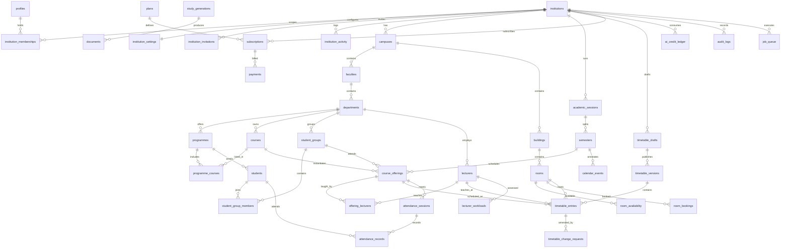

# Acadence — Database Design

> **Document ID:** DBD-001 · **Version:** 1.4 · **Status:** Approved for migration authoring · **Date:** 2026-11-27 · **Owner:** Database Architecture
> **Related:** [Architecture](../04-architecture/SYSTEM_ARCHITECTURE.md) · [SRS](../03-requirements/SRS.md) · [API](../06-api/API_SPECIFICATION.md) · [ADR-003](../13-adr/ADR-003-rls-multi-tenancy.md)

## 1. Principles

1. PostgreSQL (Supabase) is the source of truth; no business data lives only in the application.
2. Every tenant-owned table carries `institution_id uuid NOT NULL` with an FK and an index, even when derivable.
3. Composite foreign keys `(id, institution_id)` make cross-tenant references impossible at the database level.
4. Integrity that matters (overlaps, uniqueness, duplicates) is enforced by constraints, not only by services.
5. RLS is enabled on every tenant table; helper functions are `SECURITY DEFINER` with a pinned `search_path`.
6. Published timetables are immutable; corrections create new versions.
7. Migrations are additive-first and versioned in `supabase/migrations`.

## 2. Enumerated types

| Type | Values |
| --- | --- |
| `institution_status` | `pending`, `active`, `suspended`, `archived` |
| `membership_role` | `platform_admin`, `support_operator`, `institution_admin`, `faculty_admin`, `department_admin`, `lecturer`, `student` |
| `membership_status` | `invited`, `active`, `suspended`, `revoked` |
| `room_type` | `classroom`, `lecture_hall`, `laboratory`, `studio`, `seminar` (identical to `courses.required_room_type`) |
| `booking_status` | `confirmed`, `cancelled` |
| `timetable_status` | `draft`, `validated`, `published`, `superseded`, `archived` |
| `conflict_severity` | `critical`, `high`, `medium`, `low` |
| `conflict_kind` | `lecturer_overlap`, `room_overlap`, `group_overlap`, `capacity`, `suitability`, `lecturer_unavailable`, `workload`, `calendar` |
| `workload_status` | `draft`, `submitted`, `approved`, `rejected` |
| `attendance_status` | `present`, `absent`, `late`, `excused` |
| `generation_kind` | `study_guide`, `summary`, `practice_questions`, `worked_examples`, `revision_plan`, `formula_sheet` |
| `generation_status` | `queued`, `running`, `succeeded`, `failed`, `cancelled` |
| `document_approval` | `pending`, `approved`, `rejected` |
| `subscription_status` | `trialing`, `active`, `past_due`, `grace`, `expired`, `cancelled` |
| `payment_status` | `pending`, `succeeded`, `failed`, `refunded` |
| `job_status` | `queued`, `running`, `succeeded`, `failed`, `cancelled`, `pending_continuation` |
| `calendar_event_kind` | `holiday`, `exam_period`, `registration_deadline`, `event` |

## 3. Entity relationship diagram



## 4. Table catalogue

### 4.1 Identity and tenancy

| Table | Key columns | Constraints / notes |
| --- | --- | --- |
| `profiles` | `id` (= `auth.users.id`), `full_name`, `email`, `avatar_url`, `phone` | No role column: roles live in memberships only. `email` is copied from `auth.users` on signup and backfilled in Phase 3 so member lists show real identities |
| `institutions` | `id`, `name`, `slug`, `type`, `status`, `logo_url`, `brand_primary`, `brand_accent`, `timezone` | `slug` unique; `timezone` default `Africa/Lagos` |
| `institution_settings` | `institution_id` PK, `working_days smallint[]`, `slot_minutes`, `day_start`, `day_end`, `default_max_contact_hours`, `allow_teaching_in_exams`, `hard_rule_overrides jsonb` | Configurable academic rules (SRS FR-INST-007) |
| `institution_memberships` | `id`, `institution_id`, `user_id`, `role`, `faculty_id`, `department_id`, `status`, `invited_email`, `accepted_at` | `unique (institution_id, user_id)`; scope nullable only for institution-level roles; CHECK ensures role/scope consistency |
| `institution_invitations` | `id`, `institution_id`, `email`, `role`, `token_hash`, `invited_by`, `expires_at`, `accepted_at`, `revoked_at` | `token_hash` unique; partial unique index on `(institution_id, lower(email))` for live invitations; CHECK restricts invitable roles; only a SHA-256 hash is stored |
| `institution_activity` | `id` (identity), `institution_id`, `actor_id`, `action`, `summary`, `metadata jsonb`, `created_at` | Append-only: select for institution admins/support/platform; rows written by definer triggers, never by `authenticated` directly |

### 4.2 Academic structure

| Table | Key columns | Constraints |
| --- | --- | --- |
| `campuses` | `id`, `institution_id`, `name`, `code`, `address`, `archived_at` | `unique (institution_id, code)`; `unique (institution_id, id)` so children can use a composite tenant FK |
| `faculties` | `id`, `institution_id`, `campus_id`, `name`, `code`, `archived_at` | `unique (institution_id, code)`; `campus_id` **optional** (OQ-016); composite FK `(institution_id, campus_id)` → `campuses` |
| `departments` | `id`, `institution_id`, `faculty_id`, `name`, `code`, `archived_at` | `unique (institution_id, code)`; composite FK to the faculty, so a department cannot point at another tenant's faculty |
| `academic_sessions` | `id`, `institution_id`, `name`, `starts_on`, `ends_on`, `status`, `archived_at` | `unique (institution_id, name)`; CHECK `ends_on > starts_on`; `status` uses `academic_period_status` |
| `semesters` | `id`, `institution_id`, `session_id`, `name`, `sequence`, `teaching_starts_on`, `teaching_ends_on`, `exam_starts_on`, `exam_ends_on`, `status`, `archived_at` | `unique (session_id, sequence)`; CHECK teaching → exam date ordering; composite FK to the session |
| `programmes` | `id`, `institution_id`, `department_id`, `code`, `name`, `level`, `duration_years`, `archived_at` | `unique (institution_id, code)`; `level` in undergraduate/postgraduate/diploma/certificate; `duration_years` 1–8 |
| `courses` | `id`, `institution_id`, `department_id`, `code`, `title`, `units`, `level`, `required_room_type`, `required_features text[]`, `archived_at` | `unique (institution_id, code)`; `units` 1–12; `level` 100–900 in steps of 100 |
| `programme_courses` | `id`, `institution_id`, `programme_id`, `course_id`, `level`, `requirement`, `archived_at` | `unique (programme_id, course_id)`; `requirement` required/elective (OQ-017, replacing the single `courses.programme_id`) |
| `students` | `id`, `institution_id`, `user_id` (nullable), `matric_number`, `first_name`, `last_name`, `email`, `phone`, `programme_id`, `level`, `entry_session_id`, `status`, `archived_at` | `unique (institution_id, matric_number)`; partial unique `(institution_id, lower(email))`; `unique (institution_id, user_id)` so one account links to one record (OQ-020, OQ-021) |
| `lecturers` | `id`, `institution_id`, `user_id` (nullable), `staff_number`, `title`, `first_name`, `last_name`, `email`, `phone`, `department_id`, `status`, `archived_at` | `unique (institution_id, staff_number)`; partial unique `(institution_id, lower(email))`; composite FK to the department |
| `student_groups` | `id`, `institution_id`, `programme_id`, `session_id`, `level`, `name`, `code`, `expected_size`, `archived_at` | Cohort definition (OQ-022); `unique (institution_id, code)`; composite FKs to programme and session |
| `student_group_members` | `id`, `institution_id`, `group_id`, `student_id`, `archived_at` | Many-to-many membership; partial unique `(group_id, student_id) WHERE archived_at IS NULL` allows archive and restore |
| `course_offerings` | `id`, `institution_id`, `course_id`, `session_id`, `semester_id`, `coordinator_lecturer_id`, `expected_size`, `status`, `notes`, `archived_at` | `unique (semester_id, course_id)`; composite FK `(institution_id, semester_id, session_id)` → `semesters` pins the semester to its session (OQ-023) |
| `course_offering_lecturers` | `id`, `institution_id`, `offering_id`, `lecturer_id`, `role` (`lead`/`assistant`), `contact_hours`, `archived_at` | Partial unique `(offering_id, lecturer_id) WHERE archived_at IS NULL` |
| `course_offering_groups` | `id`, `institution_id`, `offering_id`, `group_id`, `archived_at` | Partial unique `(offering_id, group_id) WHERE archived_at IS NULL` |

### 4.3 Facilities

| Table | Key columns | Constraints |
| --- | --- | --- |
| `buildings` | `id`, `institution_id`, `campus_id`, `name`, `code`, `address`, `notes`, `archived_at` | `unique (institution_id, code)`; `campus_id` NOT NULL and tenant-checked (OQ-027) |
| `rooms` | `id`, `institution_id`, `building_id`, `name`, `code`, `room_type`, `capacity`, `floor`, `accessibility_notes`, `archived_at` | `unique (institution_id, code)`; `capacity` 1–5000; `room_type` shares the course vocabulary (OQ-026) |
| `room_features` | `id`, `institution_id`, `name`, `category` (`equipment`/`accessibility`/`layout`/`other`), `archived_at` | Partial unique `(institution_id, lower(name)) WHERE archived_at IS NULL` |
| `room_feature_links` | `id`, `institution_id`, `room_id`, `feature_id`, `quantity`, `archived_at` | Partial unique `(room_id, feature_id) WHERE archived_at IS NULL`; composite tenant FKs (OQ-028) |
| `room_availability` | `id`, `institution_id`, `room_id`, `semester_id`, `day_of_week`, `opens_at time`, `closes_at time`, `archived_at` | `day_of_week` 1–7; `closes_at > opens_at`; overlapping windows of one room on one day rejected by trigger (OQ-029) |
| `room_bookings` | `id`, `institution_id`, `room_id`, `semester_id`, `department_id`, `title`, `purpose`, `starts_at timestamp`, `ends_at timestamp`, `expected_attendees`, `status`, `booked_by`, `cancelled_at`, `cancelled_by` | `ends_at > starts_at`; capacity, semester window and availability checked by trigger; overlap exclusion over confirmed rows (OQ-030) |

### 4.4 Timetables

| Table | Key columns | Constraints |
| --- | --- | --- |
| `timetable_drafts` | `id`, `institution_id`, `semester_id`, `department_id`, `faculty_id`, `title`, `status`, `created_by` | Exactly one of department/faculty may be set at a time (CHECK) |
| `timetable_versions` | `id`, `institution_id`, `semester_id`, `draft_id`, `version_no`, `status`, `published_at`, `published_by`, `change_summary`, `validation_report jsonb` | `unique (semester_id, version_no)`; partial unique `(semester_id) WHERE status = 'published'` ensures one live version |
| `timetable_entries` | `id`, `institution_id`, `version_id`, `offering_id`, `room_id`, `lecturer_id`, `group_id`, `day_of_week`, `starts_at time`, `ends_at time`, `is_fixed`, `notes` | Overlap exclusions (§5); `ends_at > starts_at` |
| `timetable_change_requests` | `id`, `institution_id`, `entry_id`, `requested_by`, `proposed jsonb`, `reason`, `status`, `reviewed_by`, `reviewed_at`, `review_note` | Only open requests per entry allowed |

### 4.5 Workload, calendar, attendance

| Table | Key columns | Constraints |
| --- | --- | --- |
| `lecturer_workloads` | `id`, `institution_id`, `semester_id`, `lecturer_id`, `contact_hours`, `non_teaching_hours`, `limit_hours`, `status`, `approved_by` | `unique (semester_id, lecturer_id)`; hours `>= 0` |
| `calendar_events` | `id`, `institution_id`, `session_id`, `semester_id` (nullable), `title`, `description`, `kind`, `starts_on`, `ends_on`, `archived_at` | CHECK `ends_on >= starts_on`; composite FK `(institution_id, semester_id, session_id)` keeps an event inside its session; teaching weeks are derived, not stored (OQ-024) |
| `attendance_sessions` | `id`, `institution_id`, `offering_id`, `session_date`, `starts_at`, `ends_at`, `room_id`, `created_by` | `unique (offering_id, session_date, starts_at)` |
| `attendance_records` | `id`, `institution_id`, `attendance_session_id`, `student_id`, `status`, `recorded_by`, `recorded_at`, `note` | `unique (attendance_session_id, student_id)` |

### 4.6 Communication, AI, commerce, operations

| Table | Key columns | Constraints |
| --- | --- | --- |
| `notifications` | `id`, `institution_id`, `user_id`, `kind`, `title`, `body`, `entity_type`, `entity_id`, `read_at`, `emailed_at` | Index `(user_id, read_at)` |
| `notification_preferences` | `user_id`, `institution_id`, `kind`, `in_app`, `email` | PK `(user_id, institution_id, kind)` |
| `course_materials` | `id`, `institution_id`, `offering_id`, `title`, `storage_path`, `mime_type`, `size_bytes`, `uploaded_by` | Private bucket path prefix `institution_id/` |
| `study_generations` | `id`, `institution_id`, `user_id`, `offering_id`, `kind`, `status`, `model`, `credit_cost`, `source_ids uuid[]`, `error`, `created_at` | Credit cost > 0 |
| `documents` | `id`, `institution_id`, `generation_id`, `owner_id`, `kind`, `title`, `storage_path`, `mime_type`, `size_bytes`, `approval`, `approved_by` | Private signed access only |
| `plans` | `id`, `code`, `name`, `student_band_max`, `ai_credits_per_term`, `features jsonb`, `price_per_term`, `currency` | `code` unique; global table |
| `subscriptions` | `id`, `institution_id`, `plan_id`, `status`, `period_start`, `period_end`, `grace_until` | One current subscription per institution (partial unique where status in active/grace) |
| `payments` | `id`, `institution_id`, `subscription_id`, `provider`, `provider_reference`, `amount`, `currency`, `status`, `paid_at`, `period_start`, `period_end` | `unique (provider, provider_reference)` |
| `ai_credit_ledger` | `id`, `institution_id`, `delta`, `reason`, `reference_id`, `balance_after`, `created_at` | Append-only; `balance_after` maintained by a transactional function |
| `audit_logs` | `id`, `institution_id`, `actor_user_id`, `action`, `entity_type`, `entity_id`, `before jsonb`, `after jsonb`, `request_id`, `created_at` | Append-only; no update/delete policy |
| `job_queue` | `id`, `institution_id`, `kind`, `payload jsonb`, `status`, `attempts`, `job_key`, `checkpoint jsonb`, `last_error`, `locked_at` | `unique (job_key)` for idempotency |

## 5. Integrity under concurrency

```sql
-- Room double-booking protection (implemented in 20261127120000_facilities.sql).
-- Booking times are institution wall-clock timestamps, so a plain tsrange is used,
-- and a cancelled booking stops reserving its slot.
alter table room_bookings
  add constraint room_bookings_no_overlap
  exclude using gist (
    room_id with =,
    tsrange(starts_at, ends_at, '[)') with &&
  ) where (status = 'confirmed');

-- Capacity, the semester window and the room's availability window are checked
-- by the validate_room_booking trigger before the row is written, because they
-- need to read rooms and room_availability, which an exclusion constraint cannot.

-- Within a version: no lecturer, room or group may be double-booked.
alter table timetable_entries
  add constraint no_lecturer_overlap
  exclude using gist (
    version_id with =,
    lecturer_id with =,
    day_of_week with =,
    timerange(starts_at, ends_at) with &&
  ) where (lecturer_id is not null);

alter table timetable_entries
  add constraint no_room_overlap_in_version
  exclude using gist (
    version_id with =,
    room_id with =,
    day_of_week with =,
    timerange(starts_at, ends_at) with &&
  ) where (room_id is not null);

alter table timetable_entries
  add constraint no_group_overlap
  exclude using gist (
    version_id with =,
    group_id with =,
    day_of_week with =,
    timerange(starts_at, ends_at) with &&
  ) where (group_id is not null);
```

Requires `create extension if not exists btree_gist;`.

Publishing is a single transaction that (a) re-validates the draft, (b) marks the previous published version `superseded`, and (c) inserts the new version with `status = 'published'`. The partial unique index plus `serializable` isolation prevents two simultaneous publications.

## 6. Indexing

| Index | Purpose |
| --- | --- |
| `(institution_id, semester_id)` on offerings, versions, calendar events | Semester-scoped lists |
| `(version_id, day_of_week, starts_at)` on entries | Grid rendering |
| `(lecturer_id)` and `(group_id)` on entries | Personal timetable views |
| `(semester_id, status)` on timetable_versions | Resolve the live version |
| `(room_id, starts_at)` and `(semester_id, starts_at)` on room_bookings | Overlap lookups and semester reports |
| `(user_id, read_at)` on notifications | Unread counts |
| `(institution_id, created_at desc)` on audit_logs | Admin audit view |
| `(status, locked_at)` on job_queue | Worker polling |
| Trigram index on `courses.title`, `institutions.name` | Search |

## 7. Row Level Security model

### 7.1 Helper functions

```sql
create or replace function public.auth_institution_ids()
returns setof uuid
language sql stable security definer set search_path = public
as $$
  select institution_id
  from institution_memberships
  where user_id = auth.uid() and status = 'active';
$$;

create or replace function public.auth_role(p_institution uuid)
returns membership_role
language sql stable security definer set search_path = public
as $$
  select role
  from institution_memberships
  where user_id = auth.uid()
    and institution_id = p_institution
    and status = 'active'
  limit 1;
$$;

create or replace function public.auth_department_ids(p_institution uuid)
returns setof uuid
language sql stable security definer set search_path = public
as $$
  select department_id
  from institution_memberships
  where user_id = auth.uid()
    and institution_id = p_institution
    and status = 'active'
    and department_id is not null;
$$;

create or replace function public.is_platform_admin()
returns boolean
language sql stable security definer set search_path = public
as $$
  select exists (
    select 1 from institution_memberships
    where user_id = auth.uid() and role = 'platform_admin' and status = 'active'
      and institution_id is null
  );
$$;
```

### 7.2 Policy patterns

- **Read:** `institution_id in (select * from auth_institution_ids())`, narrowed further by role/scope where required (e.g. `department_admin` limited to `auth_department_ids(institution_id)`).
- **Write:** capability check, e.g. `auth_role(institution_id) in ('institution_admin','faculty_admin','department_admin')`, plus scope restriction for faculty/department admins.
- **Academic structure:** reads are `institution_id in (select public.auth_institution_ids())`; writes call `public.can_manage_academic_unit(institution_id, faculty_id, department_id)`, which allows institution admins anywhere in the institution, faculty admins inside `auth_faculty_ids()`, and department admins inside `auth_department_ids()`. No academic table has a DELETE policy or a DELETE grant for `authenticated` — archiving is the only removal (OQ-018).
- **Facilities:** reads are institution-wide. Buildings, rooms, features, equipment and availability are written when `auth_can_manage_facilities(institution_id)` is true, which covers institution and faculty administrators (both hold `manage_facilities`). Bookings additionally allow a department administrator when `department_id in (select auth_department_ids(institution_id))`, so a department books its own rooms and cannot touch another department's booking. The department scope is re-checked in the `WITH CHECK` of the update policy, so a booking cannot be moved out of scope.
- **People, groups, offerings and calendar:** policies resolve the owning unit first — `programme_department(programme_id)` for students and groups, `student_group_programme(group_id)` for memberships, `department_id` for lecturers, and `course_department(course_id)` / `offering_course(offering_id)` for offerings and their assignments. Calendar events are institution-level. Every helper is a definer function, so no policy reads the table it protects.
- **Student/lecturer self-service:** policies join to `students.user_id` / `lecturers.user_id` and only expose published versions.
- **Append-only tables** (`audit_logs`, `ai_credit_ledger`): no UPDATE or DELETE policies; writes happen through `SECURITY DEFINER` functions with explicit authorisation.
- **Platform tables** (plans): read for authenticated users, write only for `is_platform_admin()`.
- **Storage:** bucket policies require the object's first path segment to equal an institution the user belongs to; documents are downloaded through signed URLs after an authorisation check.

### 7.3 Testing isolation

Fixtures create two institutions with independent admins. Tests assert: direct table reads return only own rows; cross-tenant IDs produce empty results or constraint/403 errors; service functions reject foreign institution IDs; storage signed URLs cannot be requested across tenants.

Phase 4 adds `supabase/tests/academic_structure.sql`: a faculty administrator is refused a department in another faculty, a department administrator a course in another department, an inspector tenant cannot insert or update another tenant's records, a composite FK rejects a campus from another institution, one course is required by two programmes through `programme_courses`, archiving is recorded and restorable, and `authenticated` holds no DELETE privilege.

Phase 3 extends this with `supabase/tests/institution_management.sql`: invitation tokens are unreadable as table rows, `create_invitation` refuses cross-tenant and lecturer callers, acceptance requires the invited email, tokens are single-use, and activity rows never leak across tenants. The institution status/slug guard is a column-level trigger because RLS cannot restrict individual columns.

## 8. Migrations and seeding

- Every change is a new file `supabase/migrations/YYYYMMDDHHMMSS_description.sql`; no edits to applied migrations.
- Enum values are added, never removed. Column drops are two-phase (stop writing, then drop in a later release).
- RLS policies ship in the same migration as the table.
- `supabase/seed.sql` provides platform plans and a local development institution; it never contains production data.
- Generated types (`supabase gen types typescript`) are committed and updated in the same PR as the migration.

## 9. Retention and backup

| Data | Retention |
| --- | --- |
| Published timetable versions | Indefinite (institutional record) |
| Audit logs | Institution-configured, default 24 months |
| AI generations and documents | Until deleted by owner or institution policy |
| Notifications | 12 months |
| Job records | 90 days after completion |
| Backups | Daily automated, 30-day retention; restore tested each release cycle |

## 10. Revision history

| Version | Date | Author | Change |
| --- | --- | --- | --- |
| 1.0 | 2026-11-23 | Database Architecture | Initial schema, ERD, constraints and RLS model |
| 1.1 | 2026-11-25 | Engineering | Added Phase 3 invitation, activity and profile-email tables to the ERD, catalogue and isolation notes |
| 1.2 | 2026-11-25 | Engineering | Phase 4 academic structure: optional campus on faculties, composite tenant FKs, `programme_courses` replacing `courses.programme_id`, archive-only removal and the academic scope helper |
| 1.3 | 2026-11-27 | Engineering | Phase 4b people, groups, offerings and calendar tables, the `semesters` tenant-session key and derived teaching weeks |
| 1.4 | 2026-11-27 | Engineering | Phase 5 facilities: corrected `room_type` and added `booking_status`; buildings, rooms, feature catalogue, links, binding availability, dated bookings with the confirmed-only overlap exclusion and the facilities scope helper |
